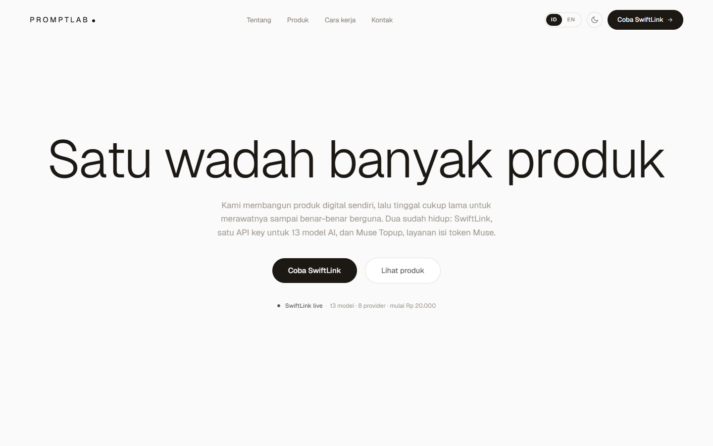
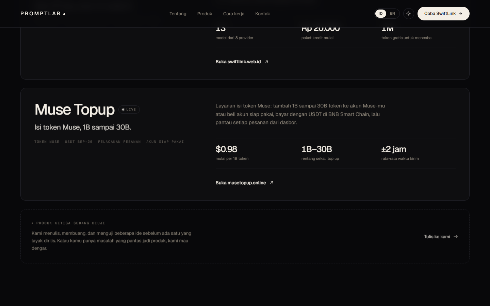
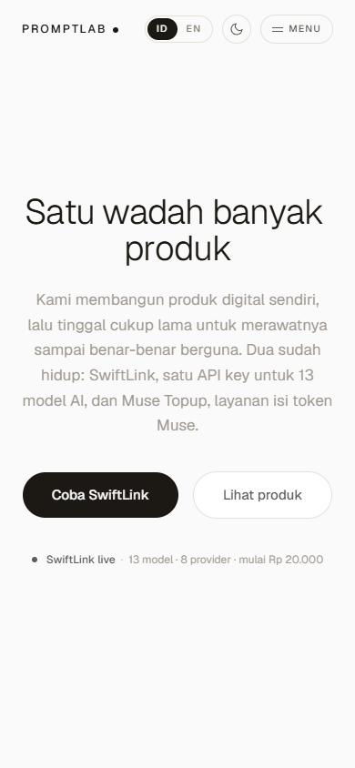

<div align="center">

# PromptLab Studios

**Website resmi PromptLab Studios, wadah produk digital yang dibangun dan dirawat dari Indonesia.**

[](https://github.com/PromptLabStudio/Genome-Probe/actions/workflows/ci.yml)


[SwiftLink](https://swiftlink.web.id) · [Muse Topup](https://musetopup.online)



</div>

## Tentang

Landing page satu halaman untuk memperkenalkan studio dan produknya. Semua teks ada di satu file, jadi konten bisa diganti tanpa menyentuh komponen.

## Fitur

- **Hero interaktif:** animasi canvas 2D yang bereaksi terhadap kursor, dipadukan dengan animasi masuk dari GSAP.
- **Dua bahasa:** Indonesia dan Inggris, pilihannya tersimpan di browser.
- **Tema terang dan gelap:** mengikuti setelan sistem dan tidak berkedip saat halaman dimuat.
- **Responsif:** tampilan disesuaikan untuk desktop, tablet, dan ponsel.
- **Ramah aksesibilitas:** menghormati setelan `prefers-reduced-motion`.
- **Ringan:** font Geist di-host sendiri, tanpa backend dan tanpa library UI tambahan.

## Tampilan

| Tema gelap | Ponsel |
| --- | --- |
|  |  |

## Mulai

Butuh Node.js 20.19+ atau 22.12+.

```bash
git clone https://github.com/PromptLabStudio/Genome-Probe.git
cd Genome-Probe
npm install
npm run dev
```

| Perintah | Fungsi |
| --- | --- |
| `npm run dev` | Menjalankan server development |
| `npm run build` | Cek tipe dengan TypeScript, lalu build ke `dist/` |
| `npm run preview` | Melihat hasil build secara lokal |

## Struktur

```text
├── public/              # Favicon dan font Geist
├── src/
│   ├── components/      # Bagian-bagian halaman (Hero, Produk, Footer, dll.)
│   ├── lib/site.tsx     # State bahasa dan tema
│   ├── content.ts       # Semua teks, versi ID dan EN
│   ├── index.css        # Design token dan style global
│   ├── App.tsx          # Susunan halaman
│   └── main.tsx         # Entry point
├── index.html
└── vite.config.ts
```

## Mengubah konten

- **Teks dan produk:** edit `src/content.ts`. Isi versi `id` dan `en` supaya kedua bahasa tetap sama.
- **Warna dan token desain:** edit `src/index.css`.
- **Tautan kontak di footer:** edit `src/components/Footer.tsx`.
- **Judul dan deskripsi SEO:** edit `index.html`.

## Deploy

Hasil build berupa file statis di `dist/`, jadi bisa dipasang di Vercel, Netlify, Cloudflare Pages, atau hosting statis lain.

| Setelan | Nilai |
| --- | --- |
| Build command | `npm run build` |
| Output directory | `dist` |

---

<div align="center">

© 2026 PromptLab Studios

</div>
